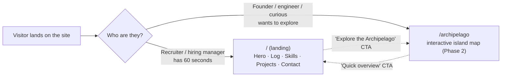

# 1. Overview

## The product, in one breath

A portfolio with **two front doors for two very different visitors**:

Why two doors? Because optimizing one experience for both audiences makes it
mediocre for each. A recruiter doesn't want to "play"; they want the résumé and
the highlights *now*. A fellow engineer might enjoy the interactive map. So we
give each what they want and let them cross over.

## The non-negotiable qualities

Everything we build is judged against these. They show up again and again as the
reason we picked one approach over another:

1. **Mobile-first** — most traffic is a phone.
2. **Fast** — Lighthouse 95+, First Contentful Paint < 1.5s.
3. **SEO-friendly** — content must be in the HTML, server-rendered.
4. **Accessible** — keyboard, screen-reader, reduced-motion.
5. **Themeable** — re-skinnable without rewriting features.
6. **Sellable as a template** — a buyer edits *data and tokens*, not components.

Keep these six in mind; the [decision log](./03-decisions.md) is basically "how
each choice serves these six."

## The tech stack and the one-line reason for each

| Tool | Role | Why this one (short version) |
|------|------|------------------------------|
| **Next.js 16** (App Router) | Framework | Server-renders HTML (good for SEO + FCP), supports static export to a CDN, and is the natural base if this grows into a SaaS. |
| **React 19** | UI library | Comes with Next; Server Components let us ship less JS. |
| **TypeScript** | Language | Types *are* the contract between layers. A template that others extend needs guardrails. |
| **Tailwind v4** | Styling | Utility classes + a token system that maps perfectly onto per-theme CSS variables. No separate config file in v4. |
| **shadcn/ui** (on **Base UI**) | Component primitives | You *own* the component code (it's copied into your repo, not a dependency), so it's themeable and sellable. Built on Base UI for accessible behavior. |
| **Motion** (Framer Motion) | Animation | Declarative animation with a built-in `useReducedMotion()` — accessibility for free. |
| **Lucide** | Icons | Clean, tree-shakeable SVG icons. |

> A longer "X instead of Y because Z" treatment of each of these is in the
> [decision log](./03-decisions.md). This table is just the map; that doc is the
> territory.

## What exists today (Phase 1)

The landing page at `/` is built and verified. It is composed of small,
single-responsibility pieces:

- **Hero** — name, role, tagline, two CTAs, and a parchment "welcome" card.
- **Captain's Log** — a vertical career timeline.
- **Tech Stack** — your skills, grouped.
- **Featured Projects** — CareSmartz360 and CropHawk.
- **Harbor** — the contact card (email, phone, LinkedIn, résumé).

All of it is driven by **your data** (`src/content/`) read through a single
**data provider**, and styled entirely through **theme tokens**. That separation
is the whole game, and it's what the next doc explains.
