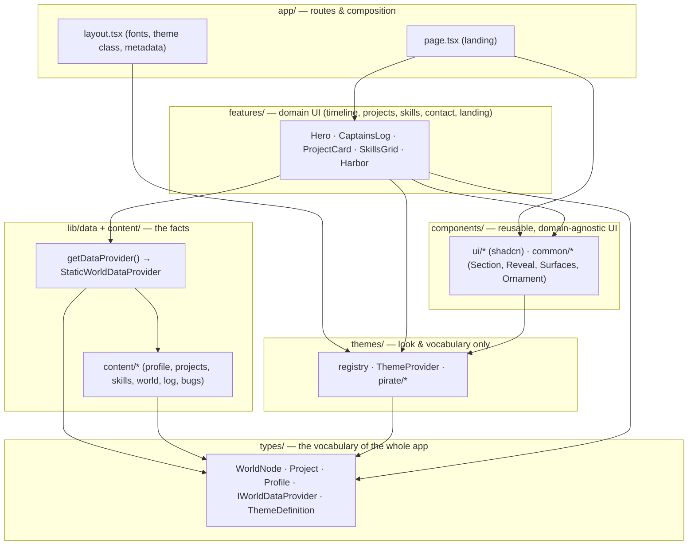
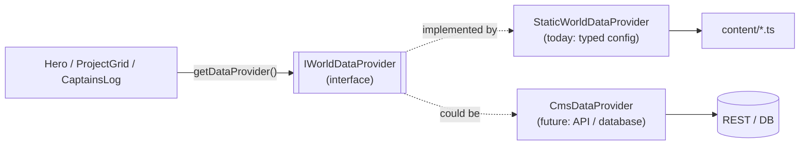
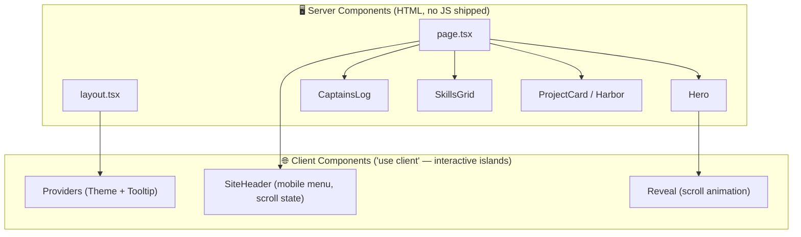
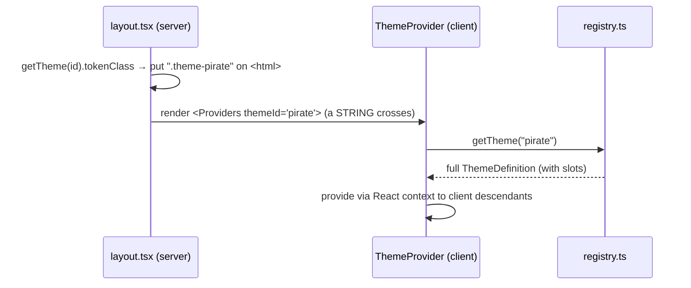
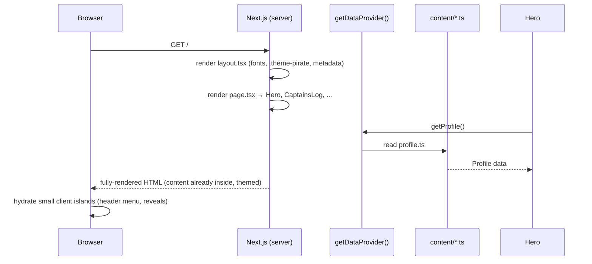

# 2. Architecture

This is the most important doc for understanding *how the pieces fit*. We'll go
layer by layer, then look at the three "seams" that make the codebase flexible,
then trace how a request becomes a page.

## The layering (and the golden rule)

The codebase is organized into layers, and **dependencies only point in one
direction**: outer layers depend on inner layers, never the reverse.



**The golden rule:** the inner layers (`types`, `content`, `data`) know *nothing*
about the outer ones. `types/` doesn't import React. `content/` doesn't import a
component. This is what lets us swap a theme, or swap the data source, without a
ripple of changes everywhere.

## The folder map

```
src/
├─ app/                      Next.js routes (the composition root)
│  ├─ layout.tsx             <html>, fonts, theme token-class, SEO metadata
│  ├─ page.tsx               the landing page — arranges sections
│  ├─ providers.tsx          client providers (Theme, Tooltip)
│  └─ globals.css            Tailwind import + all theme token blocks
│
├─ types/                    domain types — the shared contract (no React here)
│  ├─ content.ts             Profile, Project, SkillGroup, LogEntry, BugStory
│  ├─ world.ts               WorldNode, WorldEdge, World, NodeCategory
│  ├─ theme.ts               ThemeDefinition, ThemeVocabulary, ThemeSlots
│  └─ data-provider.ts       IWorldDataProvider  ← the key interface
│
├─ content/                  YOUR DATA as typed config (edit these freely)
│  ├─ profile.ts  projects.ts  skills.ts  log.ts  bugs.ts  world.ts
│
├─ lib/
│  ├─ data/                  StaticWorldDataProvider + getDataProvider()
│  ├─ icons.tsx              the ONLY file that imports the icon library
│  ├─ active-theme.ts        server-side theme/vocabulary accessor
│  └─ utils.ts               cn() class merger
│
├─ themes/                   look & vocabulary, no business logic
│  ├─ registry.ts            getTheme(id) — add a theme here and nowhere else
│  ├─ theme-provider.tsx     React context for the active theme (client)
│  └─ pirate/                vocabulary + (later) decorative slot components
│
├─ components/
│  ├─ ui/                    shadcn primitives you own (Button, Sheet, …)
│  ├─ common/                Section, Reveal, Surfaces, Ornament, SocialLinks
│  └─ layout/                SiteHeader, SiteFooter, nav-config
│
├─ features/                 domain UI, one folder per domain
│  ├─ landing/  timeline/  skills/  projects/  contact/
│
└─ config/site.ts            deploy-time config (name, url, active theme id)
```

## The three seams

A "seam" is a place where you can cut the code and replace one side without the
other noticing. We deliberately built three. They map directly onto SOLID
principles.

### Seam 1 — Content sits behind an interface (Dependency Inversion)

Nothing reads `content/` directly. Everything goes through `getDataProvider()`,
which returns something satisfying the `IWorldDataProvider` **interface**.



Why it matters: today your data is hardcoded TypeScript. The day you want a CMS
or a SaaS builder where users edit their own islands, you write **one new class**
and change **one line** in `lib/data/index.ts`. No component changes. That is the
Dependency Inversion Principle: *depend on abstractions, not concretions.*

### Seam 2 — Themes are data, not code branches (Open/Closed)

Components never say `if (theme === 'pirate')`. Instead:

- **Colours** come from CSS tokens (`bg-primary`, `text-foreground`, `bg-gold`).
  Each theme defines what those tokens *resolve to* in a single CSS block under a
  class like `.theme-pirate` in `globals.css`.
- **Words** ("Island", "Captain's Log") come from a `vocabulary` object, never
  hardcoded. The engine renders `vocabulary.nodePlural`, not `"Islands"`.
- **Decorations** (special shapes, frames) come from optional `slots` components.

```mermaid
flowchart TD
    comp["A component renders<br/>bg-primary + vocabulary.exploreCta"]
    comp --> tok{Which theme<br/>is active?}
    tok -->|.theme-pirate| pirate["--primary: gold #D4AF37<br/>exploreCta: 'Explore the Archipelago'"]
    tok -->|.theme-minimal<br/>(future)| minimal["--primary: blue<br/>exploreCta: 'View my work'"]
```

Why it matters: adding a theme = adding a CSS block + one object in the registry.
You never reopen and edit existing components. That is the Open/Closed Principle:
*open for extension, closed for modification.* This is also literally the feature
you'd sell in a template.

### Seam 3 — One responsibility per file (Single Responsibility)

- `CaptainsLog` renders a timeline. It does **not** fetch data or decide layout
  spacing — the page does that.
- `icons.tsx` is the *only* place that imports `lucide-react`. Swap icon sets by
  editing one file.
- `lib/url.ts` answers one question: "is this link external?"

Why it matters: when something breaks or needs to change, there's exactly one
obvious place to look.

## Server vs Client — where the JavaScript lives

Next.js App Router renders **Server Components by default** (they run on the
server, send HTML, ship *zero* JS to the browser). You opt a component into the
browser with `"use client"`. We keep that boundary as small as possible — it's
how we hit the performance and SEO targets.



**Rule of thumb we follow:** if it needs state, effects, or browser APIs, it's a
client component — and it should be *small*. Everything else stays on the server.
Note the critical hero text is a **Server Component with no animation wrapper**,
so it's visible instantly (great for LCP) and even works with JavaScript disabled.

### The one tricky bit: passing the theme across the boundary

A `ThemeDefinition` can contain component functions (the `slots`). Functions
**can't be serialized** from server to client. So we never pass the theme object
across the boundary — we pass the **`themeId` string**, and the client
`ThemeProvider` looks the full definition up itself.



Server components that need vocabulary don't use the hook — they call
`getActiveVocabulary()` (`lib/active-theme.ts`) directly. Same data, no client
boundary.

## How a request becomes a page (the whole trip)



Because the HTML arrives complete and themed, the page is fast, indexable, and
readable without waiting on JavaScript. The interactive bits "hydrate" afterward
as a progressive enhancement.
