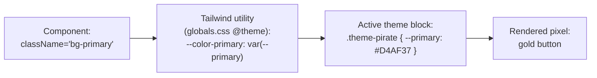

# 4. Theming Guide

This is the feature that turns "my portfolio" into "a template I can sell." A
theme controls three things and **nothing else**:

1. **Tokens** — what the colours/radii resolve to (a CSS block).
2. **Vocabulary** — the words shown ("Island" vs "Planet" vs "Project").
3. **Slots** *(optional)* — decorative components unique to the theme.

A theme contains **no business logic and no data**. That separation (from
[Architecture › Seam 2](./02-architecture.md#seam-2--themes-are-data-not-code-branches-openclosed))
is what makes re-skinning safe.

## How a colour actually reaches the screen

Follow one colour, `primary`, on its journey:



Swap the theme class on `<html>` and the *same component* renders a different
colour, because `--primary` now resolves to something else. No component is
touched.

There are two token families in `globals.css`:

- **Semantic tokens** (`--primary`, `--background`, `--card`, `--muted`, …) — used
  by shadcn components. Restyle these and the whole UI follows.
- **Brand tokens** (`--brand-gold`, `--brand-parchment`, …, exposed as `bg-gold`,
  `text-parchment`) — for the handful of theme-specific decorations that need a
  literal brand colour.

## The theme contract (in code)

A theme is a `ThemeDefinition` (`src/types/theme.ts`):

```ts
interface ThemeDefinition {
  id: string;              // "pirate"
  meta: { name; description };
  tokenClass: string;      // "theme-pirate" — the CSS class to put on <html>
  vocabulary: ThemeVocabulary;   // the labels
  slots: ThemeSlots;       // optional decorative components (start empty)
}
```

The registry (`src/themes/registry.ts`) is the single place that knows all
themes:

```ts
const registry = { [pirateTheme.id]: pirateTheme };
export function getTheme(id) { return registry[id] ?? registry[DEFAULT]; }
```

And the active theme is chosen in `src/config/site.ts`:

```ts
themeId: "pirate"
```

## Walkthrough: add a "Minimal" theme

Here's the whole process. Notice we **never open a component file**.

**Step 1 — add the token block** in `src/app/globals.css`:

```css
.theme-minimal {
  --background: #ffffff;
  --foreground: #0a0a0a;
  --primary: #2563eb;          /* blue instead of gold */
  --primary-foreground: #ffffff;
  --card: #f7f7f8;
  --card-foreground: #0a0a0a;
  --muted: #f0f0f2;
  --muted-foreground: #555;
  --border: rgba(0,0,0,0.08);
  --ring: #2563eb;
  /* brand tokens still need values so bg-gold etc. don't break */
  --brand-gold: #2563eb;
  --brand-parchment: #f7f7f8;
  --brand-ink: #0a0a0a;
  /* …fill the rest mirroring .theme-pirate… */
  --radius: 0.5rem;
}
```

**Step 2 — create the theme object**, `src/themes/minimal/theme.ts`:

```ts
import type { ThemeDefinition } from "@/types";

export const minimalTheme: ThemeDefinition = {
  id: "minimal",
  meta: { name: "Minimal", description: "Clean, neutral, business-like." },
  tokenClass: "theme-minimal",
  vocabulary: {
    worldName: "My Work",
    worldNameShort: "Work",
    nodeSingular: "Project",
    nodePlural: "Projects",
    exploreCta: "View my work",
    skimCta: "Quick overview",
    logTitle: "Timeline",
    graveyardTitle: "Lessons Learned",
    harborTitle: "Contact",
    mapPrompt: "Pick a project",
  },
  slots: {},
};
```

**Step 3 — register it**, `src/themes/registry.ts`:

```ts
import { minimalTheme } from "./minimal/theme";
const registry = {
  [pirateTheme.id]: pirateTheme,
  [minimalTheme.id]: minimalTheme,   // ← one line
};
```

**Step 4 — activate it**, `src/config/site.ts`:

```ts
themeId: "minimal"
```

Done. The hero now says "View my work," the timeline is "Timeline," buttons are
blue — and you changed **four files, none of them components**. That is the
Open/Closed Principle paying for itself, and it's the core sellable feature.

## When you'd reach for `slots`

Most theming is tokens + vocabulary. `slots` exist for the rare case where a theme
needs a genuinely different *shape* — e.g. the pirate theme drawing an island
marker with a torn-parchment label, while a sci-fi theme draws a glowing hex. The
engine renders `theme.slots.NodeMarker ?? <DefaultMarker/>`, so a theme can ignore
slots entirely and still work. We'll populate the pirate slots when we build the
map in Phase 2.
