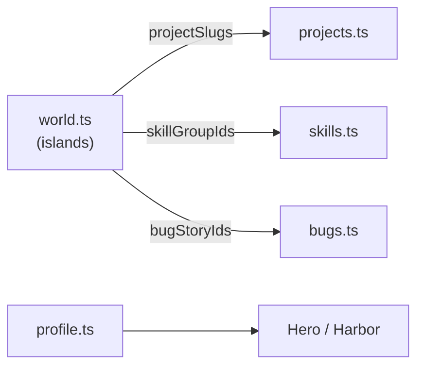

# 5. Content Guide

This doc is the practical "I want to change what the site says" reference. All of
your real information lives in **`src/content/`** as typed TypeScript. Edit these
files; the components update automatically because they read through the
[data provider](./02-architecture.md#seam-1--content-sits-behind-an-interface-dependency-inversion).

> **Tip:** after editing, the dev server hot-reloads. If a type is wrong, the
> editor (and `npm run typecheck`) tells you exactly where.

## Where each thing lives

| File | What it holds | Shows up in |
|------|---------------|-------------|
| `content/profile.ts` | Name, role, tagline, bio, location, email, phone, résumé URL, social links | Hero, Harbor, footer, page metadata |
| `content/skills.ts` | Skill groups (Backend, Distributed Systems, …) | Tech Stack section |
| `content/projects.ts` | Your projects (title, tagline, highlights, tech, status) | Featured Projects, future map panels |
| `content/log.ts` | Career timeline entries | Captain's Log |
| `content/bugs.ts` | "Lessons learned" stories | Graveyard of Bugs (Phase 3) |
| `content/world.ts` | The islands + the routes between them | The map (Phase 2) |
| `config/site.ts` | Site name, canonical URL, **active theme** | Everywhere / SEO |

## How the data connects together

The world map's islands don't *contain* projects — they **reference** them by id.
This keeps each fact in one place (no duplication).



So `crophawk-atoll` in `world.ts` just says `projectSlugs: ["crophawk"]`, and the
data provider resolves that to the full project from `projects.ts`. Change the
project once; everywhere that references it updates.

## Common edits

**Change your tagline / bio:** `content/profile.ts` → `tagline`, `bio`.

**Add a GitHub link** (currently omitted — it wasn't on your résumé): add to the
`socials` array in `profile.ts`:

```ts
{ label: "GitHub", href: "https://github.com/your-handle", kind: "github" },
```

The `github` icon already exists in the registry, so it just works.

**Add a project:** append an object to the `projects` array. The shape is enforced
by the `Project` type. `featured: true` makes it appear on the landing page.
`status` is one of `"shipped" | "in-progress" | "experiment" | "archived"` and
drives the coloured badge.

**Add a skill group:** append to `skillGroups` in `skills.ts`. The `iconKey` must
be a key the icon registry knows (see below).

**Add a timeline entry:** append to `logEntries` in `log.ts` (oldest first).

## Icon keys

Content references icons by string. The available keys live in `src/lib/icons.tsx`.
Current set:

```
Wayfinding:  compass, anchor, ship, map, waves, sparkles
Categories:  monolith, microservice, infrastructure, research, graveyard, harbor, telescope
Domains:     frontend, backend, database, cloud, tools, workflow, ml, drone,
             blockchain, pathfinding, healthcare, education
Content:     leaf, log
Social:      github, linkedin, email, phone, resume, external
```

Need a new one? Add a line to `iconRegistry` in `lib/icons.tsx` (the only file
that imports the icon library) — e.g. `security: ShieldCheck`. Then any content
can use `iconKey: "security"`. An unknown key falls back to a neutral circle, so a
typo degrades gracefully instead of crashing.

## Long-form stories (MDX)

Each project can have a long-form narrative rendered at `/projects/<slug>`. The
**structured metadata** (title, tagline, tech, highlights, status) stays in
`projects.ts`; the **prose** lives in an MDX file. This split is deliberate — data
that the UI reasons about is typed; the storytelling is Markdown.

To add or edit a story:

1. Create/edit `src/content/stories/<slug>.mdx` — plain Markdown (start at `##`;
   the page renders the project title as the `<h1>`). You can use **bold**,
   lists, `> blockquotes`, and links. Styling is automatic via
   `src/mdx-components.tsx`.
2. Register it in `src/content/stories/index.ts`:

   ```ts
   "<slug>": () => import("./<slug>.mdx"),
   ```

That's it. The `/projects/[slug]` page is statically generated for every project
(`generateStaticParams`), shows the metadata header + highlights, and appends the
MDX body when a story is registered. Project cards and the map's detail panel link
to it via "Read the story."

> **MDX gotchas:** a bare `<` or `{` is interpreted as JSX — avoid them in prose
> (write "under 1.5s", not "<1.5s"). Escape a literal asterisk as `\*` or spell it
> out ("A-star").

## The résumé file

The Hero and Harbor "Résumé" buttons link to `/resume.pdf`, which is served from
`public/resume.pdf`. Your real résumé (`resume2025.pdf`) is already copied there.
To update it, just replace that file.
