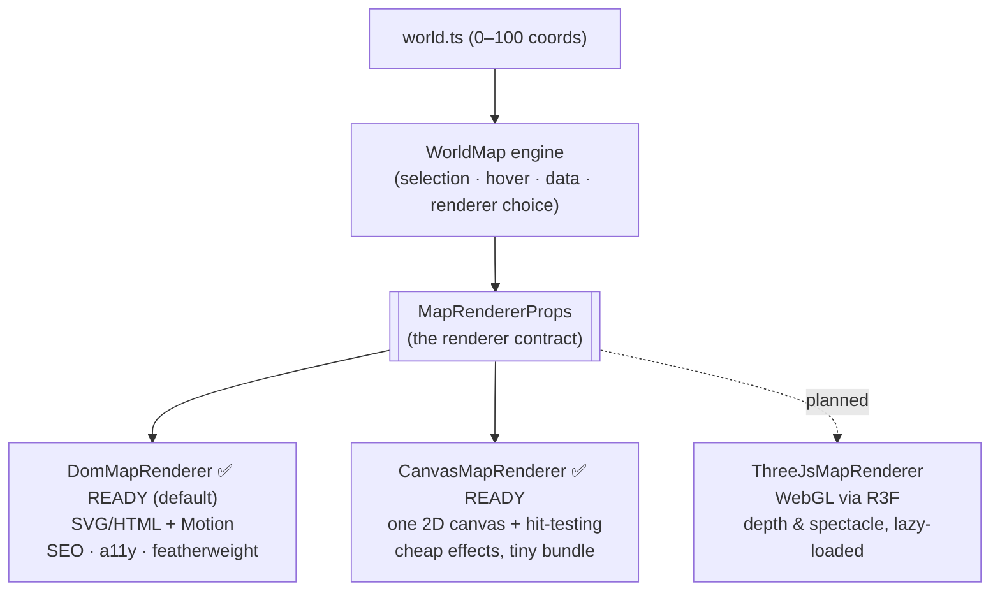

# 6. Rendering the Map: 2D vs React Three Fiber

This is the decision you wanted to talk through, so this doc goes deeper and
stays **balanced** — I'll make the honest case for *both* sides, then give a
recommendation. By the end you should be able to defend whichever choice we make.

## What we're actually choosing between

The interactive map (`/archipelago`, Phase 2) shows islands you can hover, click,
and pan around. There are two broad ways to render it:

- **2D approach** — an illustrated map image as the background, with islands as
  regular HTML/SVG elements positioned on top (using the normalized 0–100
  coordinates from [ADR-13](./03-decisions.md#adr-13--normalized-0100-map-coordinates-instead-of-pixel-coordinates)),
  animated with Motion. It's "just the DOM."
- **3D approach** — **React Three Fiber (R3F)**, which is React bindings for
  **Three.js**, the WebGL library. The map becomes a real 3D scene rendered on a
  `<canvas>` by the GPU: actual island meshes, a camera you fly, lighting, depth.

`drei` is a helper library on top of R3F (camera controls, loaders, etc.).

## First, understand what "3D on the web" really costs

This isn't anti-3D bias — it's the physics of the platform. Four real costs:

**1. JavaScript weight.** Three.js is roughly **~150 KB gzipped**; add R3F + drei
+ your models/textures and the *interactive map alone* can dwarf the entire rest
of the site. Our whole landing page ships a few KB of JS. That weight fights the
**Lighthouse 95+** and **FCP < 1.5s** targets directly.

**2. The GPU/battery/mobile reality.** A WebGL scene runs a render loop on the
GPU. On a mid-range Android phone that means heat, battery drain, fan-spin on
laptops, and jank if the scene is complex. Our **#1 quality is mobile-first.** 3D
is where mobile suffers most.

**3. SEO and the "content in a canvas" black hole.** A `<canvas>` is opaque to
crawlers and link-preview bots. Text drawn in WebGL is *pixels*, not words. Island
names, descriptions, project links rendered in 3D are invisible to search engines
and to anything reading the HTML. We'd have to maintain a parallel DOM copy just
for SEO. With the 2D approach the island labels *are* real HTML — indexed for
free.

**4. Accessibility.** A canvas has no DOM for a screen reader to read and no
focusable elements for keyboard navigation. You must rebuild focus management,
ARIA, and a non-visual path by hand. With 2D, each island is a real `<button>`/
`<a>` — keyboard-focusable and screen-reader-readable by default. Our **accessible**
quality nearly falls out for free in 2D and becomes a project in 3D.

There's also **complexity**: 3D means model formats (glTF), texture compression,
camera math, lighting, and a much larger surface for bugs — on a feature whose job
is "let a recruiter click an island."

## The honest case *for* 3D

I don't want to strawman it. 3D genuinely wins when:

- **The "wow" *is* the product.** If the differentiator of this portfolio is "you
  have to see this map move," a cinematic 3D fly-through is memorable in a way a 2D
  map isn't. For a creative/founder audience, spectacle has real value.
- **Depth and continuous camera motion matter** — parallax, tilt, zooming into an
  island's geometry. 2D can fake some of this (layered parallax) but not true
  depth.
- **You want to learn Three.js.** That's a legitimate reason for a *personal*
  project, even if it's not the "engineering-optimal" one. Learning is a goal too.

The reference design you shared, though, is a **2D illustrated treasure map** —
beautiful, but flat art. We can reproduce that look *exactly* in 2D. We'd only
need 3D if we want to go *beyond* that reference into real depth.

## The decision: a three-tier renderer seam, DOM shipped first

Here's the part that makes this not a one-way door. The islands are stored as
renderer-agnostic 0–100 coordinates ([ADR-13](./03-decisions.md#adr-13--normalized-0100-map-coordinates-instead-of-pixel-coordinates)),
and the engine talks to a renderer through an **interface** (`MapRendererProps`).
We registered **three tiers** and implemented the first:

**Why three, not two?** (Credit: this was Suvrt's call.) `Canvas 2D` is the
*middle tier* people forget. The DOM is wonderfully accessible but gets heavy when
you have hundreds of animated elements (every node is layout + paint). Three.js
fixes performance but drags in 3D complexity and ~150KB. A single 2D `<canvas>`
sits between them: **huge performance, easy effects (fog, particles, animated
routes), tiny bundle — without full 3D.** So if the map ever grows past what the
DOM handles comfortably, Canvas is the next step *before* reaching for WebGL.

You can see all three in the app's renderer switcher (bottom-left of the map):
**`DOM` and `Canvas` are both live and switchable**; `WebGL` is visibly
**planned**. Flip between DOM and Canvas on the map and watch the *same* islands,
routes, and selection redraw through a completely different rendering strategy —
the engine, data, and detail panel never change. That's the architecture made
tangible.

### How the Canvas tier keeps its accessibility

The headline knock against canvas is that it's opaque to screen readers and
keyboards. The `CanvasMapRenderer` solves this with a **hybrid**: everything
*visible* is painted on one `<canvas>` (the perf/effects win), mouse and touch
use **canvas hit-testing**, but a layer of **transparent, focusable buttons** is
positioned over each island. Those buttons are `pointer-events-none` (so the
canvas owns the mouse) yet remain keyboard-focusable and carry the `aria-label`s
— so Tab/Enter and screen readers work exactly as they do on the DOM renderer.
Canvas for pixels, a thin DOM layer for semantics.

When we implement Canvas or Three later, the recipe is the same:

- Write the renderer component to satisfy `MapRendererProps`.
- Flip its `status` to `"ready"` in `renderers/registry.ts`.
- For Three specifically: **lazy-load** it (`next/dynamic`), keep DOM as the
  default and the fallback for mobile / reduced-motion / no-WebGL / crawlers.

No engine, data, or app change. Same Open/Closed move as the theme system.

## Why this is the better *story*, not just the better code

(Also Suvrt's framing, and it's right.) The renderer seam isn't only an
engineering hedge — it's the **narrative**. Compare two answers to "what's the
coolest thing you've built lately?":

> *"I built a React portfolio."*

versus

> *"I built a configurable world-map engine where each domain of my work is an
> island, the data is renderer-agnostic, and it can be drawn by a DOM renderer
> today or a WebGL one tomorrow — without touching the engine."*

The second is a *systems* answer. It signals you think in interfaces and
extension points, not pages. That's worth more in a conversation with a founder
or senior engineer than any single visual — and it's exactly what makes this
sellable as a template.

## Decision matrix

| Criterion | 2D (DOM/SVG + Motion) | 3D (React Three Fiber) |
|---|---|---|
| Mobile performance | ✅ excellent | ⚠️ heavy; needs care |
| JS bundle size | ✅ tiny | ❌ large (~150KB+ just for Three) |
| FCP / LCP / Lighthouse 95+ | ✅ easy | ❌ hard |
| SEO (text indexable) | ✅ real HTML | ❌ canvas is opaque |
| Accessibility (keyboard/SR) | ✅ near-free | ❌ build it yourself |
| Matches your reference art | ✅ exactly (it's 2D art) | ➖ overkill for flat art |
| "Wow" / spectacle | ➖ good | ✅ unmatched |
| True depth & camera fly-through | ❌ faked at best | ✅ real |
| Build complexity / bug surface | ✅ low | ❌ high |
| Learning Three.js | ➖ no | ✅ yes |

## What we decided, and how it's built

We chose **2D (DOM) now, behind a three-tier renderer seam** — the best
engineering trade-off, and it keeps the spectacle door open. The pieces, all in
`src/features/world-map/`:

| File | Responsibility |
|------|----------------|
| `world-map.tsx` | The **engine** — owns selection/hover state, picks the renderer, renders the detail panel and the renderer switcher. Theme-agnostic. |
| `renderers/types.ts` | The renderer **contract** (`MapRendererProps`) and the three-tier `MapRendererId`. |
| `renderers/registry.ts` | Registers `dom` (ready, default), `canvas` (ready), `three` (planned). The one place to flip a tier on. |
| `renderers/dom-map-renderer.tsx` | The **DOM renderer**: SVG routes + focusable island buttons on an aspect-correct plane, with pan/zoom. |
| `renderers/canvas-map-renderer.tsx` | The **Canvas renderer**: one `<canvas>` (ocean, routes, medallions, labels) + pointer hit-testing + a transparent focusable-button a11y layer. |
| `use-map-camera.ts` | Pan/zoom logic (renderer-specific — a WebGL camera would differ). |
| `components/map-node.tsx` | The default island marker (themeable via the `NodeMarker` slot). |
| `components/map-detail-panel.tsx` | The slide-over panel; resolves the island's projects/skills/bugs via the data provider. |
| `components/map-controls.tsx` | The zoom/recenter cluster (pure callbacks). |

Notice the separations: the **engine** owns *what is selected*; the **renderer**
owns *how it's drawn and how the camera moves*; the **theme** owns *what a node
looks like* (slot) and *what it's called* (vocabulary); the **data provider**
owns *the facts*. Four independent axes of change — that's the payoff of the
seams from [doc 2](./02-architecture.md).

### If you later want the spectacle (Three.js)

The door is open and the path is mechanical:

1. Add `renderers/three-map-renderer.tsx` implementing `MapRendererProps`.
2. `next/dynamic(() => import("./three-map-renderer"), { ssr: false })` so the
   heavy WebGL bundle loads **only** when that tier is selected.
3. Flip its `status` to `"ready"` in the registry.
4. Keep `dom` as the default + fallback (mobile, reduced-motion, no-WebGL, bots).

Nothing else changes. That's the whole point of building it this way.
